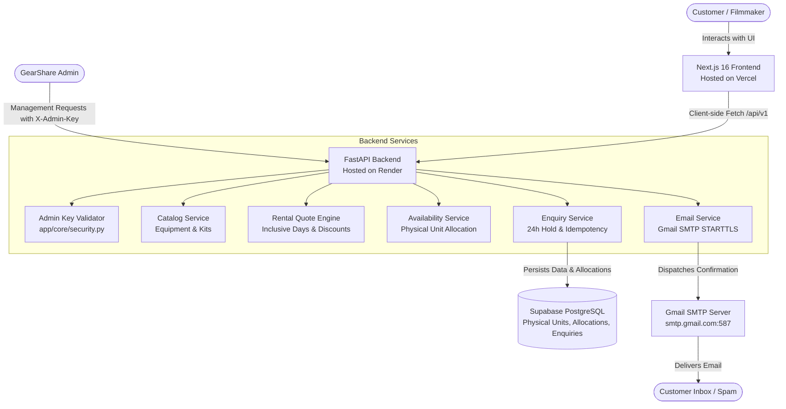

# GearShare

> **Premium Photography & Filmmaking Equipment Rental Platform**  
> *Developed for the ZootechX Software Development Internship Technical Assignment.*

[](https://nextjs.org/)
[](https://react.dev/)
[](https://www.typescriptlang.org/)
[](https://tailwindcss.com/)
[](https://threejs.org/)
[](https://fastapi.tiangolo.com/)
[](https://www.python.org/)
[](https://www.sqlalchemy.org/)
[](https://supabase.com/)
[](https://docs.pytest.org/)

---

## 🌐 Live Demo

The GearShare application is deployed and accessible online:

- **Frontend Application:** [https://gearshare-two.vercel.app/](https://gearshare-two.vercel.app/)
- **Backend REST API:** [https://gearshare-5gl6.onrender.com](https://gearshare-5gl6.onrender.com/)
- **Swagger / Interactive API Docs:** [https://gearshare-5gl6.onrender.com/docs](https://gearshare-5gl6.onrender.com/docs)
- **API Health Check:** [https://gearshare-5gl6.onrender.com/api/v1/health](https://gearshare-5gl6.onrender.com/api/v1/health)

### Cloud Infrastructure
- **Frontend Hosting:** [Vercel](https://vercel.com/) (Next.js 16 Edge / Serverless)
- **Backend Hosting:** [Render](https://render.com/) (FastAPI / Uvicorn Python Web Service)
- **Database:** [Supabase PostgreSQL](https://supabase.com/) (Managed PostgreSQL with connection pooling)

---

## Table of Contents

- [🌐 Live Demo](#-live-demo)
- [1. Project Overview](#1-project-overview)
- [2. Key Features](#2-key-features)
- [3. Technology Stack](#3-technology-stack)
- [4. System Architecture](#4-system-architecture)
- [5. Repository Structure](#5-repository-structure)
- [6. Application Workflow](#6-application-workflow)
- [7. Local Development Setup](#7-local-development-setup)
- [8. Environment Variable Reference](#8-environment-variable-reference)
- [9. Database Documentation & Migrations](#9-database-documentation--migrations)
- [10. API Specification & Admin Authentication](#10-api-specification--admin-authentication)
- [11. Rental Business Logic & Quoting Engine](#11-rental-business-logic--quoting-engine)
- [12. Email Notification System (Gmail SMTP)](#12-email-notification-system-gmail-smtp)
- [13. Testing & Verification](#13-testing--verification)
- [14. Production Deployment Guide](#14-production-deployment-guide)
- [15. Security & Production Hardening](#15-security--production-hardening)
- [16. Screenshots & Demonstrations](#16-screenshots--demonstrations)
- [17. Current Scope & Future Improvements](#17-current-scope--future-improvements)
- [18. Author & Repository Info](#18-author--repository-info)

---

## 1. Project Overview

**GearShare** is a full-stack, boutique peer-to-peer and studio equipment rental web application engineered for cinematographers, directors of photography, content creators, and indie filmmakers. 

### Value Proposition
- **Access Over Ownership:** High-end cinema equipment (e.g., Sony FX30, Nikon Z8, Aputure 300D II, DJI Ronin 4D, Sachtler Flowtech tripods) can be rented without prohibitive capital expenditures.
- **Curated Creator Kits:** Complete production packages (such as the *Content Creator Kit* or *Filmmaker Kit*) bundled with multi-component packages.
- **Accurate, Authoritative Quotes:** Real-time pricing calculations featuring inclusive calendar duration and automated multi-day discount curves.
- **Date-Wise Physical Inventory Management:** Real physical units (tracked via individual serial numbers and asset codes) are checked against date ranges with exclusion constraints to prevent overlapping reservations.
- **Enquiry-Driven Reservation Workflow:** Customers submit verified rental enquiries. Upon submission, equipment is placed under an **atomic 24-hour temporary inventory hold** pending administrative review and dispatch scheduling, with transactional confirmation emails delivered via Gmail SMTP.

> **Note on Workflow:** GearShare is designed around an **enquiry and review model**. It does not perform instant automated credit card charging; enquiries place a temporary 24-hour hold on physical stock while the production team reviews shoot details, security deposits, and identity verification.

---

## 2. Key Features

### Frontend (Next.js 16 / React 19)
- **Dark Cinematic Visual Theme:** High-contrast film-production palette (`#060708`, `#0c0d0e`) with glassmorphism, responsive navigation, and smooth scrolling via Lenis.
- **3D Lens Interactive Hero:** Interactive 3D WebGL camera lens canvas powered by `@react-three/fiber` and `@react-three/drei`.
- **Catalogue & Category Showcase:** Dynamic browsing across 6 key film gear categories: *Cameras*, *Lenses*, *Lighting*, *Stabilization*, *Audio*, and *Accessories*.
- **Interactive Rental Calculator:** Configurable equipment selections, quantity selectors, live date pickers, and dynamic pricing previews.
- **Creator Kit Configurator:** Select bundled kits with real-time component availability inspection and add-on equipment options.
- **Live Form Validation:** Indian mobile phone sanitization and strict validation (`^[6-9]\d{9}$`) with static `+91` prefixing.
- **Enquiry Confirmation Screen:** Dynamic feedback showing the generated enquiry reference (`GS-YYYY-XXXX`), hold countdown, and delivery status of the customer's confirmation email.
- **Contact Message Portal:** Built-in form submitting general queries to the backend.

### Backend (FastAPI / SQLAlchemy 2.0 / PostgreSQL)
- **FastAPI REST Engine:** Asynchronous, OpenAPI-documented architecture with centralized exception handling and Pydantic v2 schemas.
- **Calendar-Day Duration Logic:** Inclusive start/end day calculation (`duration = (endDate - startDate) + 1 day`).
- **Physical Inventory Tracking:** Separate `EquipmentUnit` assets tracking real-world serial numbers, asset tags, operational statuses, and maintenance conditions.
- **Non-Overlapping Allocations:** PostgreSQL `tsrange` date-range reservation tracking ensuring no physical unit can be double-booked.
- **Atomic 24-Hour Temporary Hold:** Background expiry mechanisms releasing physical units if enquiries are unconfirmed or cancelled.
- **Idempotency Protection:** SHA-256 request payload hashing and `Idempotency-Key` headers preventing duplicate orders and double emails on network retries.
- **Transactional Gmail SMTP Delivery:** Automatic dispatch of branded HTML/plain-text confirmation emails directly to the customer's entered address.
- **Admin API Authentication:** Constant-time API key verification (`verify_admin_key`) protecting internal management routes.

---

## 3. Technology Stack

### Frontend
- **Framework:** [Next.js 16.4.3](https://nextjs.org/) (Turbopack, App Router)
- **UI Library:** [React 19.0.0](https://react.dev/) / React DOM 19
- **Language:** [TypeScript 5.7.3](https://www.typescriptlang.org/)
- **Styling:** [Tailwind CSS 4.3.3](https://tailwindcss.com/) & PostCSS
- **3D / WebGL:** [Three.js 0.187.0](https://threejs.org/), `@react-three/fiber 9.8.2`, `@react-three/drei 10.7.9`
- **Animations:** [Framer Motion 14.9.0](https://www.framer.com/motion/), [GSAP 3.15.0](https://gsap.com/), [Lenis 1.3.27](https://lenis.darkroom.engineering/)
- **Icons:** [Lucide React 1.16.0](https://lucide.dev/)

### Backend
- **Framework:** [FastAPI 0.115+](https://fastapi.tiangolo.com/)
- **ASGI Server:** [Uvicorn 0.32+](https://www.uvicorn.org/)
- **ORM:** [SQLAlchemy 2.0.35+](https://www.sqlalchemy.org/)
- **Data Validation:** [Pydantic 2.9+](https://docs.pydantic.dev/) & [pydantic-settings 2.5+](https://docs.pydantic.dev/latest/concepts/pydantic_settings/)
- **Database Migrations:** [Alembic 1.13.3+](https://alembic.sqlalchemy.org/)
- **Database Driver:** [Psycopg 3.2+ (binary)](https://www.psycopg.org/psycopg3/)
- **Testing:** [Pytest 8.3+](https://docs.pytest.org/), [HTTPX 0.27+](https://www.python-httpx.org/)
- **Email Delivery:** Standard Python `smtplib` + `email.mime` (Gmail SMTP over STARTTLS)

### Infrastructure & Deployment
- **Frontend Hosting:** [Vercel](https://vercel.com/)
- **Backend Hosting:** [Render](https://render.com/)
- **Database:** [Supabase PostgreSQL](https://supabase.com/) (Managed PostgreSQL 15+ with SSL & Connection Pooler)
- **Version Control:** [GitHub](https://github.com/Tejeshub/GearShare)

---

## 4. System Architecture



---

## 5. Repository Structure

```text
GearShare/
├── Frontend/                           # Next.js 16 Web Application
│   ├── app/
│   │   ├── globals.css                 # Core CSS design tokens & Tailwind imports
│   │   ├── layout.tsx                  # Root layout, metadata & font definitions
│   │   ├── page.tsx                    # Homepage: Hero, Catalogue, Kits, Calculator
│   │   └── rental-enquiry/
│   │       └── page.tsx                # Enquiry checkout form & confirmation view
│   ├── components/
│   │   ├── CinematicHero.tsx           # 3D interactive WebGL camera lens canvas
│   │   ├── SmoothScrollProvider.tsx    # Lenis smooth-scroll provider
│   │   └── ui/button.tsx               # Reusable UI button component
│   ├── lib/
│   │   ├── api/
│   │   │   ├── client.ts               # Centralized fetch wrapper & base URL resolver
│   │   │   ├── errors.ts               # Custom ApiError mapping class
│   │   │   ├── index.ts                # API client barrel export
│   │   │   ├── types.ts                # TypeScript data interfaces & request contracts
│   │   │   └── services/               # Modular service callers (equipment, kits, rentals)
│   │   ├── enquiry-service.ts          # Frontend enquiry submission layer
│   │   ├── products.ts                 # Product catalogue data models
│   │   ├── rental-quote.ts             # Client quote calculation helpers
│   │   └── utils.ts                    # Class name utilities (clsx, tailwind-merge)
│   ├── public/                         # Static assets (3D GLB models, product imagery)
│   ├── next.config.mjs                 # Next.js configuration
│   ├── package.json                    # Frontend dependencies & npm scripts
│   ├── tsconfig.json                   # TypeScript compiler configuration
│   └── .env.example                    # Frontend environment variable template
│
├── Backend/                            # FastAPI Application
│   ├── alembic/                        # Database migration scripts
│   │   ├── versions/                   # Ordered Alembic migration revisions (1 to 5)
│   │   └── env.py                      # Alembic migration runner configuration
│   ├── app/
│   │   ├── api/                        # Route controllers
│   │   │   ├── availability.py         # Date-wise unit & kit availability checks
│   │   │   ├── catalog.py              # Equipment, Categories & Creator Kits routes
│   │   │   ├── contact.py              # Contact form submission endpoint
│   │   │   ├── health.py               # Application & database health check
│   │   │   └── rentals.py              # Rental quote calculation & enquiry endpoints
│   │   ├── core/
│   │   │   ├── config.py               # Pydantic BaseSettings (.env loading & CORS)
│   │   │   └── security.py             # Admin API key constant-time authentication
│   │   ├── db/
│   │   │   ├── base.py                 # Declarative Base
│   │   │   ├── dependencies.py         # Database session dependency (get_db)
│   │   │   ├── seed.py                 # 12-item equipment & kit catalogue seeder
│   │   │   ├── seed_inventory.py       # Physical equipment units seeder
│   │   │   └── session.py              # Engine & sessionmaker configuration
│   │   ├── models/                     # SQLAlchemy 2.0 ORM models
│   │   │   ├── catalog.py              # Category, Equipment, CreatorKit, CreatorKitItem
│   │   │   ├── contact.py              # ContactMessage
│   │   │   ├── enquiry.py              # RentalEnquiry, RentalEnquiryItem, IdempotencyRecord
│   │   │   └── inventory.py            # EquipmentUnit, RentalAllocation
│   │   ├── schemas/                    # Pydantic request/response schemas
│   │   │   ├── availability.py         # Availability check contracts
│   │   │   ├── catalog.py              # Equipment & kit schemas
│   │   │   ├── contact.py              # Contact message schemas
│   │   │   ├── enquiry.py              # Rental enquiry payloads & details
│   │   │   └── rentals.py              # Quote calculation schemas
│   │   ├── services/                   # Business logic layers
│   │   │   ├── availability_service.py # Date range intersection & stock check
│   │   │   ├── catalog_service.py      # Equipment & category queries
│   │   │   ├── email_service.py        # Gmail SMTP transactional mailer
│   │   │   ├── enquiry_service.py      # Atomic enquiry creation & allocation
│   │   │   └── rental_quote_service.py # Authoritative pricing & discount engine
│   │   └── main.py                     # FastAPI application factory & middleware
│   ├── tests/                          # Automated Pytest suite
│   │   ├── conftest.py                 # In-memory SQLite fixtures & mock clients
│   │   ├── test_availability.py        # 24 physical inventory tests
│   │   ├── test_catalog.py             # 19 catalogue & kit tests
│   │   ├── test_contact.py             # 2 contact portal tests
│   │   ├── test_enquiry.py             # 43 enquiry, lifecycle & security tests
│   │   ├── test_health.py              # 3 health & database connectivity tests
│   │   └── test_rental_quote.py        # 23 quoting & discount curve tests
│   ├── alembic.ini                     # Alembic configuration file
│   ├── requirements.txt                # Python package dependencies
│   └── .env.example                    # Backend environment variable template
│
├── .gitignore                          # Comprehensive monorepo gitignore
├── AGENTS.md                           # AI pairing guidelines & Next.js rules
└── README.md                           # Master technical documentation
```

---

## 6. Application Workflow

```text
[1. EXPLORE]
Customer browses Equipment Catalogue or Creator Kits on the Homepage
    │
    ▼
[2. CONFIGURE]
Customer chooses rental dates and equipment quantities
Frontend sends preview request to POST /api/v1/rentals/quote
    │
    ▼
[3. QUOTE ENGINE]
Backend calculates authoritative quote:
• Inclusive rental days = (End Date - Start Date) + 1
• Multi-day duration discount applied automatically
• Bundled kit components priced with kit package savings
    │
    ▼
[4. SUBMIT ENQUIRY]
Customer fills details (+91 10-digit phone, email, name)
Frontend generates Idempotency-Key and calls POST /api/v1/rentals/enquiries
    │
    ▼
[5. ATOMIC RESERVATION & PERSISTENCE]
Backend executes atomic PostgreSQL transaction:
1. Re-verifies date-wise inventory availability for physical units
2. Persists RentalEnquiry record
3. Generates item snapshots (RentalEnquiryItem)
4. Creates non-overlapping RentalAllocation records for physical units
5. Initiates a 24-hour temporary inventory hold (hold_expires_at)
6. Records IdempotencyRecord to protect against duplicate retries
7. Commits transaction to database
    │
    ▼
[6. TRANSACTIONAL CONFIRMATION DISPATCH]
Post-commit, Backend dispatches email via Gmail SMTP (STARTTLS):
• Recipient: customer's submitted email address
• Sender: GearShare Rentals via configured Gmail address
• If SMTP succeeds: confirmation_email_sent = True
• If SMTP fails: error logged in DB, enquiry is NEVER rolled back
    │
    ▼
[7. CONFIRMATION FEEDBACK]
Frontend renders "Rental Enquiry Received" screen:
• Displays unique reference (GS-YYYY-XXXX)
• Shows active 24-hour hold expiration timestamp
• Shows dynamic notification:
  - If sent: "Your confirmation email has been sent to [customer email]..."
  - If unavailable: "Your rental enquiry has been received successfully..."
    │
    ▼
[8. ADMIN LIFECYCLE MANAGEMENT]
Team reviews shoot details, deposit, and ID verification:
• Admin accesses GET /api/v1/rentals/enquiries using X-Admin-Key
• Admin updates status via PATCH /api/v1/rentals/enquiries/{ref}/status:
  - Confirmed: Hold becomes locked reservation
  - Rejected / Cancelled: Physical units released back to inventory pool
```

---

## 7. Local Development Setup

### Prerequisites
- **Git:** Installed on system
- **Node.js:** v20.x or v22.x LTS (`node -v`)
- **npm:** v10.x (`npm -v`)
- **Python:** 3.12+ (`python3 --version`)
- **PostgreSQL:** Local PostgreSQL or cloud instance on Supabase

---

### Step 1: Clone Repository
```bash
git clone https://github.com/Tejeshub/GearShare.git
cd GearShare
```

---

### Step 2: Backend Setup (FastAPI)

1. **Navigate to Backend Directory:**
   ```bash
   cd Backend
   ```

2. **Create and Activate Virtual Environment:**
   - **Linux / macOS:**
     ```bash
     python3 -m venv .venv
     source .venv/bin/activate
     ```
   - **Windows (PowerShell):**
     ```powershell
     python -m venv .venv
     .venv\Scripts\Activate.ps1
     ```

3. **Install Dependencies:**
   ```bash
   pip install --upgrade pip
   pip install -r requirements.txt
   ```

4. **Configure Environment Variables:**
   Create a `.env` file from `.env.example`:
   ```bash
   cp .env.example .env
   ```
   Edit `Backend/.env` with your Supabase database credentials, admin key, and Gmail App Password:
   ```ini
   APP_NAME="GearShare API"
   APP_ENV="development"
   DEBUG=true

   # Supabase / PostgreSQL Connection
   DATABASE_URL="postgresql+psycopg://postgres:[YOUR-PASSWORD]@[YOUR-HOST].pooler.supabase.com:5432/postgres?sslmode=require"

   # Security & Authentication
   SECRET_KEY="generate-a-secure-random-secret-key"
   ADMIN_API_KEY="create-an-admin-secret-key"
   ALLOWED_ORIGINS="http://localhost:3000,http://127.0.0.1:3000"

   # Email Configuration (Gmail SMTP)
   EMAIL_PROVIDER=gmail
   EMAIL_ENABLED=true
   SMTP_HOST=smtp.gmail.com
   SMTP_PORT=587
   SMTP_USERNAME=your_gmail@gmail.com
   SMTP_PASSWORD="your-16-character-google-app-password"
   EMAIL_FROM="GearShare Rentals <your_gmail@gmail.com>"
   ```

5. **Apply Database Migrations:**
   ```bash
   alembic upgrade head
   ```

6. **Seed Initial Catalogue and Physical Units (Optional for fresh DB):**
   ```bash
   python -m app.db.seed
   python -m app.db.seed_inventory
   ```

7. **Start Backend Server:**
   ```bash
   uvicorn app.main:app --reload --host 0.0.0.0 --port 8000
   ```
   - API Root: `http://localhost:8000`
   - Interactive Swagger Docs: `http://localhost:8000/docs`
   - ReDoc: `http://localhost:8000/redoc`

---

### Step 3: Frontend Setup (Next.js)

1. **Open a new terminal and navigate to Frontend:**
   ```bash
   cd Frontend
   ```

2. **Install Dependencies:**
   ```bash
   npm install
   ```

3. **Configure Environment Variables:**
   Create `Frontend/.env.local`:
   ```bash
   cp .env.example .env.local
   ```
   Ensure it points to your local FastAPI backend:
   ```ini
   NEXT_PUBLIC_API_BASE_URL=http://localhost:8000
   ```

4. **Start Frontend Development Server:**
   ```bash
   npm run dev
   ```
   - Application URL: `http://localhost:3000`
   - Rental Enquiry Checkout: `http://localhost:3000/rental-enquiry`

---

## 8. Environment Variable Reference

### Frontend Environment Variables (`Frontend/.env.local`)
| Variable | Required | Default | Purpose |
| :--- | :---: | :--- | :--- |
| `NEXT_PUBLIC_API_BASE_URL` | **Yes** | `http://localhost:8000` | Backend API root URL consumed by centralized `apiClient`. In production, set to your Render backend URL. |

> **Security Note:** Never add database passwords, SMTP credentials, or secret keys to `Frontend/.env.local`. Variables with `NEXT_PUBLIC_` are bundled directly into client-side JavaScript.

---

### Backend Environment Variables (`Backend/.env`)
| Variable | Required | Default / Example | Purpose |
| :--- | :---: | :--- | :--- |
| `APP_NAME` | No | `"GearShare API"` | Application identifier displayed in OpenAPI docs. |
| `APP_ENV` | No | `"development"` | Environment mode (`development`, `test`, `production`). |
| `DEBUG` | No | `false` | Enables verbose debug mode and docs in production. |
| `DATABASE_URL` | **Yes** | `postgresql+psycopg://...` | Connection URI for PostgreSQL database. |
| `SECRET_KEY` | **Yes** | *(64-char hex)* | Cryptographic salt used for security operations and token hashing. |
| `ADMIN_API_KEY` | **Yes** | *(random secret)* | Secret token required to access administrative API endpoints via `X-Admin-Key`. |
| `ALLOWED_ORIGINS` | **Yes** | `http://localhost:3000` | Comma-delimited list of authorized CORS origins. |
| `EMAIL_PROVIDER` | No | `gmail` | Active transactional email service provider. |
| `EMAIL_ENABLED` | No | `true` | Boolean switch to enable/disable SMTP email dispatch. |
| `SMTP_HOST` | **Yes\*** | `smtp.gmail.com` | SMTP relay server host (*required if `EMAIL_ENABLED=true`). |
| `SMTP_PORT` | **Yes\*** | `587` | SMTP port (`587` for STARTTLS). |
| `SMTP_USERNAME` | **Yes\*** | `your_gmail@gmail.com` | Authenticated Gmail account username. |
| `SMTP_PASSWORD` | **Yes\*** | `abcd efgh ijkl mnop` | Google App Password (16 characters, 2FA enabled). |
| `EMAIL_FROM` | **Yes\*** | `GearShare <your_gmail@gmail.com>` | Sender identity shown in the customer's email client. |

---

## 9. Database Documentation & Migrations

GearShare uses **PostgreSQL 15+** on Supabase managed via **SQLAlchemy 2.0** ORM and **Alembic**.

### Key Tables & Relational Schema
- `categories`: Rental equipment categories (*Cameras, Lenses, Lighting, etc.*).
- `equipment`: Unique catalogue products, rental daily rates, specs, and featured flags.
- `equipment_units`: Actual physical assets with individual `serial_number`, `asset_code`, condition status, and operational availability.
- `creator_kits`: Multi-item curated packages with daily bundle rates.
- `creator_kit_items`: Maps equipment and included default quantities into specific creator kits.
- `rental_enquiries`: Core customer enquiry records storing customer contact information, requested dates, duration, total estimate, 24-hour hold expiration, and email delivery flags.
- `rental_enquiry_items`: Immutable snapshots of items requested during an enquiry.
- `rental_allocations`: Reserves specific `equipment_units` for specific date ranges (`tsrange`) with exclusion constraints to prevent overlapping double bookings.
- `idempotency_records`: Tracks request payload hashes and client idempotency keys to ensure retry safety.
- `contact_messages`: General customer messages submitted through the homepage contact form.

### Alembic Migration History
1. `b4c60415402c`: Initial schema creating `categories`, `equipment`, `creator_kits`, and `creator_kit_items`.
2. `e5c5a5374f1f`: Adds physical inventory tracking via `equipment_units` and `rental_allocations` with PostgreSQL `btree_gist` exclusion constraints.
3. `1030fa095d60`: Creates `rental_enquiries`, `rental_enquiry_items`, and `idempotency_records`.
4. `f3a22d142c22`: Adds `contact_messages` table for general inquiries.
5. `e942b1d070d2`: Adds confirmation email delivery columns (`confirmation_email_sent`, `confirmation_email_error`, `confirmation_email_sent_at`) to `rental_enquiries`.

### Migration Commands
```bash
# Check current database revision against head
alembic current

# Apply all pending migrations safely
alembic upgrade head

# View migration history
alembic history --verbose
```

---

## 10. API Specification & Admin Authentication

All endpoints are prefixed under `/api/v1`. Full OpenAPI specification is available at `http://localhost:8000/docs`.

### Authentication Mechanism
Administrative endpoints require constant-time API key validation via the `verify_admin_key` dependency.
To authenticate, supply either:
- **Header:** `X-Admin-Key: <ADMIN_API_KEY>`
- **Authorization Header:** `Authorization: Bearer <ADMIN_API_KEY>`

Requests missing or supplying invalid keys receive `HTTP 401 Unauthorized`.

---

### Complete Endpoint Reference

| Method | Endpoint | Access | Purpose | Request Body / Query Params |
| :--- | :--- | :---: | :--- | :--- |
| `GET` | `/api/v1/health` | **Public** | Health & DB connection check | None |
| `GET` | `/api/v1/categories` | **Public** | List equipment categories | `active_only=true` |
| `GET` | `/api/v1/categories/{slug}` | **Public** | Get category details by slug | None |
| `GET` | `/api/v1/equipment` | **Public** | Paginated catalogue listing | `category`, `search`, `brand`, `rentable`, `page`, `limit` |
| `GET` | `/api/v1/equipment/{id}` | **Public** | Get equipment details | None |
| `GET` | `/api/v1/kits` | **Public** | List Creator Kits with bundled items | `active_only=true` |
| `GET` | `/api/v1/kits/{id}` | **Public** | Get Creator Kit details | None |
| `POST` | `/api/v1/rentals/quote` | **Public** | Calculate authoritative rental quote | `productSelections`, `kitId`, `startDate`, `endDate` |
| `GET` | `/api/v1/availability/equipment/{id}` | **Public** | Date-wise physical stock check | `startDate`, `endDate`, `quantity` |
| `GET` | `/api/v1/availability/kits/{id}` | **Public** | Check stock for all kit components | `startDate`, `endDate`, `quantity` |
| `POST` | `/api/v1/rentals/enquiries` | **Public** | Submit enquiry & place 24h hold | Payload + `Idempotency-Key` header |
| `GET` | `/api/v1/rentals/enquiries/{ref}` | **Public** | Customer reference status lookup | None (masks internal unit identifiers) |
| `GET` | `/api/v1/rentals/enquiries` | **Admin** | List all customer enquiries | Requires `X-Admin-Key`. `status`, `page`, `limit` |
| `PATCH` | `/api/v1/rentals/enquiries/{ref}/status` | **Admin** | Update enquiry status lifecycle | Requires `X-Admin-Key`. `{"status": "Confirmed"}` |
| `POST` | `/api/v1/contact` | **Public** | Submit contact inquiry message | `{"name", "email", "message"}` |

---

## 11. Rental Business Logic & Quoting Engine

### 1. Inclusive Calendar-Day Duration
GearShare uses standard equipment rental industry convention:
$$\text{Duration (days)} = (\text{End Date} - \text{Start Date}) + 1$$
*Example:* Picking up gear on Friday (`2026-11-20`) and returning Sunday (`2026-11-22`) equals **3 calendar rental days**.

### 2. Multi-Day Duration Discount Curve
Longer rental durations automatically earn tiered discount incentives:
- **1 – 2 Days:** Standard daily rate (0% discount).
- **3 – 6 Days:** 10% discount on subtotal.
- **7 – 13 Days:** 15% discount on subtotal.
- **14+ Days:** 20% discount on subtotal.

### 3. Creator Kit Bundling & Additional Quantities
When a customer selects a Creator Kit:
- The base package price covers all included bundled components for the duration.
- If the customer requests additional units of a product already included in the kit, only the *excess quantity* above the kit's bundled quota is charged at individual catalogue rates.

### 4. Atomic 24-Hour Hold & Expiry
- When an enquiry is created, physical units are tagged with `RESERVED` status.
- An automatic hold expiration timestamp is set: `hold_expires_at = now() + 24 hours`.
- If an enquiry is unconfirmed after 24 hours, background cleanup routines transition it to `EXPIRED`, releasing the physical units.

---

## 12. Email Notification System (Gmail SMTP)

GearShare utilizes **Gmail SMTP with STARTTLS** to send automated confirmation emails directly to whichever email address the customer submits in the rental form.

### Email Highlights
- **Dynamic Recipient:** Delivered directly to `RentalEnquiry.email` (e.g. `customer@gmail.com`).
- **Sender Identity:** Uses configured `EMAIL_FROM` with the authenticated Gmail username.
- **Cinematic HTML & Text Multi-Part:** Branded dark theme featuring customer name, enquiry reference code, shoot dates, calendar duration, 24-hour hold expiration notice, itemized equipment breakdown table, and estimated total quote.
- **Non-Blocking Post-Commit Dispatch:** If SMTP authentication or network transport fails, the enquiry is **never rolled back**. The error reason is saved in `rental_enquiries.confirmation_email_error`, and the customer is advised to save their reference ID.
- **Idempotency:** Re-submitting an enquiry with the same `Idempotency-Key` returns the cached record immediately without duplicating emails.

### Generating a Google App Password
1. Sign in to your Google Account.
2. Go to **Security** $\rightarrow$ **2-Step Verification** (must be enabled).
3. Scroll to **App Passwords**.
4. Generate a new App Password named `GearShare Backend`.
5. Copy the 16-character password into `Backend/.env` as `SMTP_PASSWORD="xxxx xxxx xxxx xxxx"`.

---

## 13. Testing & Verification

The project includes an extensive Pytest suite and complete frontend TypeScript and production build validations.

### 1. Backend Automated Tests (114 Passed)
Run all backend tests using the local SQLite in-memory test fixture:
```bash
cd Backend
source .venv/bin/activate
pytest -v
```
**Test Coverage Breakdown:**
- `test_availability.py` (24 tests): Date-wise stock checks, maintenance exclusion, overlapping date rejections, physical allocation atomicity.
- `test_catalog.py` (19 tests): Category listings, sorting, equipment filtering, kit listings, CRUD operations.
- `test_rental_quote.py` (23 tests): Daily rates, multi-day discount curves, Creator Kit component bundling, decimal precision.
- `test_enquiry.py` (43 tests): Atomic enquiry creation, 24-hour hold tracking, lifecycle state transitions, idempotency replays, customer privacy masking, and **admin API key authentication verification**.
- `test_health.py` (3 tests): Application lifecycle and database connectivity checks.
- `test_contact.py` (2 tests): Contact form message submission and validation.

---

### 2. Frontend Type Checking & Production Build
```bash
cd Frontend

# Validate TypeScript without compilation errors
npx tsc --noEmit

# Test Next.js production build & static generation
npm run build
```

---

## 14. Production Deployment Guide

### Phase 1: Database Setup (Supabase)
1. Create a new PostgreSQL project on [Supabase](https://supabase.com/).
2. In **Project Settings** $\rightarrow$ **Database**, copy the connection string.
3. Ensure the connection uses **Transaction Pooler** or **Session Pooler** (port `5432` or `6543`) with `sslmode=require`.
4. Ensure the `btree_gist` extension is enabled (Alembic migration `e5c5a5374f1f` enables it automatically).

---

### Phase 2: Backend Deployment (Render)
1. Sign in to [Render](https://render.com/) and click **New +** $\rightarrow$ **Web Service**.
2. Connect your GitHub repository: `https://github.com/Tejeshub/GearShare`.
3. Configure service settings:
   - **Name:** `gearshare-api`
   - **Root Directory:** `Backend`
   - **Environment:** `Python 3`
   - **Build Command:**
     ```bash
     pip install -r requirements.txt && alembic upgrade head
     ```
   - **Start Command:**
     ```bash
     uvicorn app.main:app --host 0.0.0.0 --port $PORT
     ```
4. **Environment Variables in Render:**
   - `DATABASE_URL`: `postgresql+psycopg://postgres:[PASSWORD]@[HOST]:5432/postgres?sslmode=require`
   - `SECRET_KEY`: *(Generate a 64-character secret string)*
   - `ADMIN_API_KEY`: *(Create a secure random secret for administrative requests)*
   - `ALLOWED_ORIGINS`: `https://[YOUR-VERCEL-APP].vercel.app,http://localhost:3000`
   - `EMAIL_PROVIDER`: `gmail`
   - `EMAIL_ENABLED`: `true`
   - `SMTP_HOST`: `smtp.gmail.com`
   - `SMTP_PORT`: `587`
   - `SMTP_USERNAME`: `your_gmail@gmail.com`
   - `SMTP_PASSWORD`: `your-google-app-password`
   - `EMAIL_FROM`: `GearShare Rentals <your_gmail@gmail.com>`

---

### Phase 3: Frontend Deployment (Vercel)
1. Sign in to [Vercel](https://vercel.com/) and click **Add New...** $\rightarrow$ **Project**.
2. Import the `GearShare` repository.
3. Configure project settings:
   - **Framework Preset:** `Next.js`
   - **Root Directory:** `Frontend`
   - **Build Command:** `npm run build`
   - **Output Directory:** `.next`
4. **Environment Variables in Vercel:**
   - `NEXT_PUBLIC_API_BASE_URL`: `https://[YOUR-RENDER-BACKEND-SERVICE].onrender.com`
5. Click **Deploy**.

---

### Phase 4: Final CORS Sync & Live Test
1. Copy the final assigned Vercel URL (e.g. `https://gearshare.vercel.app`).
2. Go back to Render $\rightarrow$ `gearshare-api` $\rightarrow$ **Environment**.
3. Update `ALLOWED_ORIGINS` to include your production Vercel domain.
4. Open the Vercel site, navigate to `/rental-enquiry`, and submit a live test enquiry.
5. Confirm the enquiry is recorded in Supabase, physical stock is reserved, and confirmation email arrives in the customer's inbox.

---

## 15. Security & Production Hardening

- **No Secrets in Frontend:** The frontend only contains the public `NEXT_PUBLIC_API_BASE_URL`. Database credentials, Google App Passwords, and administrative keys are stored strictly in backend server environment variables.
- **Git Hygiene:** Monorepo `.gitignore` ensures `.env`, `.env.local`, and build artifacts are never tracked in Git.
- **Constant-Time Comparison:** Admin authentication uses Python's `secrets.compare_digest` to mitigate side-channel timing attacks.
- **Input Sanitization:** Indian phone numbers are pre-sanitized and validated with regex `^[6-9]\d{9}$`. String types are preserved to prevent integer truncation.
- **Internal Asset Masking:** Public enquiry lookups hide internal serial numbers, unit IDs, and maintenance logs.
- **Gmail SMTP Volume Limitations:** Gmail SMTP is ideal for demonstration and low-volume assignment verification (up to 500 emails/day under Google policy). For high-volume production, GearShare's modular `EmailService` can be pointed to Amazon SES, SendGrid, or Postmark by updating SMTP host settings.

---

## 16. Screenshots & Demonstrations

*The following UI views represent the verified GearShare user experience:*

| Section | Description | Asset Location |
| :--- | :--- | :--- |
| **01. Cinematic Hero** | Interactive 3D WebGL Camera Lens hero with dark cinematic aesthetic. | `public/images/why-gearshare/studio-rig.jpg` |
| **02. Catalogue** | 12 high-end cinema cameras, lenses, and lighting products. | `public/images/products/` |
| **03. Creator Kits** | Pre-bundled production packages with component inspection. | `public/images/kits/` |
| **04. Rental Calculator** | Live interactive duration and quote calculator with discounts. | `/rental-enquiry#calculator` |
| **05. Enquiry Confirmation** | Reference badge, 24-hour hold status, and live email confirmation notice. | `/rental-enquiry` |

> *To add updated walkthrough screenshots to the README, capture full-resolution PNGs of your deployed site, save them into `Frontend/public/screenshots/`, and embed them using ``.*

---

## 17. Current Scope & Future Improvements

### Implemented Scope
- Complete enquiry-driven rental reservation pipeline.
- Date-wise physical stock checking with non-overlapping constraints.
- Multi-day quote calculation and Creator Kit bundled discount logic.
- Atomic 24-hour temporary inventory holds.
- Transactional Gmail SMTP confirmation email notifications.
- Admin API key authentication on enquiry management endpoints.
- Mobile-responsive dark cinematic design with 3D lens interaction.

### Planned Future Enhancements (Post-Assignment)
- **Payment Gateway Integration:** Adding Razorpay or Stripe for automated security deposit capture.
- **Customer Account Portal:** User authentication to track historical and ongoing rental enquiries.
- **Interactive Admin Dashboard:** Graphical interface for reviewing and confirming enquiries without API tools.
- **Automated WhatsApp Notifications:** Twilio WhatsApp integration for delivery notifications.

---

## 18. Author & Repository Info

- **Project Name:** GearShare
- **Repository:** [https://github.com/Tejeshub/GearShare](https://github.com/Tejeshub/GearShare)
- **Author:** Tejesh Shigwan
- **Submission Context:** Technical assignment submission for the Software Development Internship at **ZootechX**.
- **Licensing:** Proprietary. Developed as an internship assignment evaluation project.
